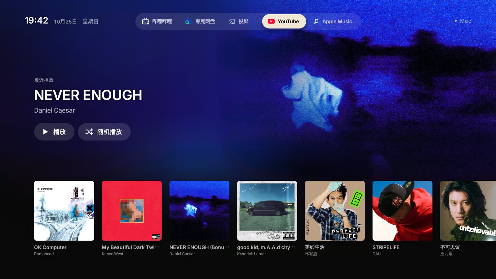
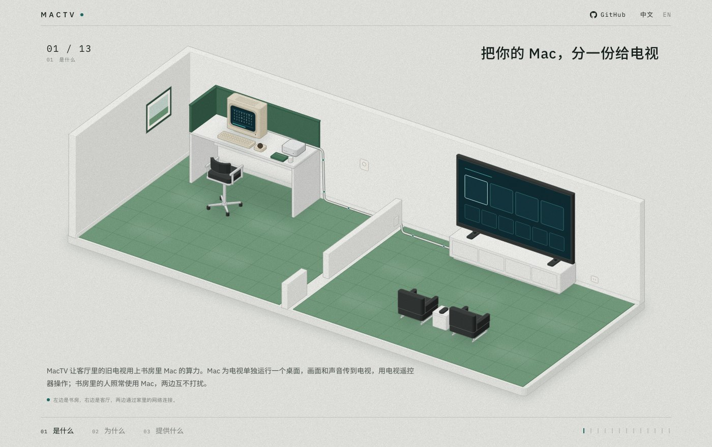

# MacTV

**把你的 Mac，分一份给电视。** MacTV 让 Android 电视在你的 Mac 上有一个自己的桌面。这是一个独立的 macOS
会话：在 Mac 上渲染，连同它自己的声音传到电视上，用电视遥控器操作。这不是投屏：Mac 和电视同时共用一台电脑，
两边互不打扰。

**网站：https://mactv-6k2.pages.dev** · [English](README.md) · [概念：每一部分为什么存在](docs/concepts.md) · [讲解网页](site/public/index.html) ·
[给 agent：AGENTS.md](AGENTS.md) · [协议](docs/protocol.md)



*我们电视现在的主页。顶部的 YouTube 和 Apple Music 会在 Mac 上属于电视的桌面里打开；下面"最近播放"的专辑，
来自 Mac 上运行的 Apple Music 数据服务。这个主页启动器本身是另一个项目，不在本仓库中。*

## 站位

大多数家庭都有一台性能很强、一天里大部分时间闲着的电脑，也有几块弱屏幕：老电视、停止更新的平板。它们的屏幕和
视频解码器都还够用，拖后腿的是上面的一切：处理器太慢，浏览器没人维护，缺应用。MacTV 是"把强设备借给弱屏幕"
的第一个具体实现：**Mac 借一个桌面给电视。**

| MacTV 是 | MacTV 不是 |
|---|---|
| 属于电视的第二个**隔离**桌面，有自己的声音和输入 | 投屏或镜像主人的屏幕 |
| **双向**的：电视发按键、指针、文字和意图（"打开 YouTube"），Mac 告诉电视前台是什么、要不要弹键盘 | 单向视频流 |
| 一套**运行时**：传输协议、Mac 端引擎、参考接收端、自愈、诊断、测试 | 只适用于一个客厅的脚本 |
| 对**应用**通用（每个应用一个 `app.json`），对**电视**通用（任何 Android 电视，差异写在设备档案里），通过[接收端契约](docs/receiver-contract.md)对**显示设备**通用 | 对主机操作系统通用：主机只做 macOS（原因见[概念 §4.1](docs/concepts.md#41-why-the-host-is-macos-only)） |

还没解决的：借多少算力、什么时候借（算力分配）；同时服务多台电视；画面流加密（目前只适合家庭网络）。

## 怎么工作：六层，各回答一个问题

| 层 | 问题 | 答案 |
|---|---|---|
| 1 桌面 | 电视的桌面放在哪，才不占用主人的？ | 一个单独的 macOS 用户，借助屏幕共享的"会话选择"，在控制台之外保持运行 |
| 2 眼睛 | 怎么只看到、只听到那个桌面？ | 用 ScreenCaptureKit 采集那个会话的显示器；用 CoreAudio 只接那个会话里正在出声的进程，并在 Mac 本机静音 |
| 3 链路 | 电视怎么找到 Mac、证明自己被允许、拿到能解的画面流？ | PING → PAIR（PIN 码）→ HELLO（报告能力）/ Welcome（选定的流）→ 数据包，码率自适应 |
| 4 手 | 遥控器怎么操作那个桌面？ | 按键和指针作为屏幕共享的输入进入会话；文字和意图直接交给网页 |
| 5 应用 | 什么值得借？ | 桌面浏览器能跑的任何东西，每个应用一个带 `app.json` 的文件夹；另有数据服务 |
| 6 照看 | 怎么在没人看着时也一直能用？ | launchd 拉起、漂移自动修复、保护进程、`mactv doctor`；电视会说是哪一环断了 |

每个握手为什么这样设计、背后做过哪些实验，见 [docs/concepts.md](docs/concepts.md)。

自带两个应用：**Apple Music**（盖在 Apple 网页播放器上、为遥控器设计的完整电视界面）和 **YouTube**（用它自己的电视界面）。

## 快速开始

最省事：在这个仓库里打开一个编程 agent，粘贴 [PROMPT.md](PROMPT.md)。它会按 [AGENTS.md](AGENTS.md) 一步步做，
只在需要你亲自动手时找你。

手动安装：

1. Mac（macOS 14.2+、Apple 芯片、Chrome，并执行过 `xcode-select --install`）：新建一个标准用户 `mactv`，在系统设置
   里打开"屏幕共享"并允许这个用户。→ [docs/setup-mac.md](docs/setup-mac.md)
2. 运行 `host/bin/mactv install`。然后进入那个会话一次：允许 MacTV Host 录屏，并登录各个应用。最后运行
   `host/bin/mactv doctor` 检查。
3. 电视：在开发者选项里打开 USB 或网络调试。编译 `tv/`，用 `adb install` 装上接收端并打开它。在 Mac 上运行
   `mactv pair`，在电视上输入显示的 PIN 码。→ [docs/setup-tv.md](docs/setup-tv.md)

## 不用电视也能测试

```bash
cd host && swift build -c release && cd ..
python3 tests/test_protocol.py        # Mac 端以测试模式运行：合成画面和测试音，不需要任何权限
```

## 现状与限制

最初那套流程（4K60 HEVC、按会话隔离的声音、Apple Music 和 YouTube、自愈）在一台 Mac mini（Apple 芯片）和一台海信
50H55E（Android 9）上做成，用有线网络，日常一直在用。这个仓库把那套东西做成了通用的：协议第 1 版（握手、配对、
协商、自适应码率）、应用描述文件、设备档案、独立的接收端。这些已在 Mac 上通过协议测试，还需要在真机上跑一遍。
欢迎提交设备报告：[examples/devices](examples/devices)。

限制：
- 会话机制依赖屏幕共享未公开的行为，macOS 更新后可能失效（[docs/session.md](docs/session.md)）。
- 画面流没有加密，只适合在家庭网络里用。
- 一次只能连一台电视。
- 目前只支持 Android 电视，其他显示设备需要另写接收端。

## 网页



[mactv-6k2.pages.dev](https://mactv-6k2.pages.dev) 用一个书房和一个客厅的剖面图，滚动讲解这个项目。源码在
[site/](site/README.md)。

## 致谢

- [cleanyourtv](https://github.com/Gathin23/cleanyourtv) 启发了这个项目。它让编程 agent 通过 ADB 清理安卓电视，
  换上简洁的主页；让我们看到，可以由 agent 来改造客厅里的电视。
- 网页上的插图用 [Anatomy](https://github.com/wheresryan22/anatomy)（MIT 许可）绘制，代码及其许可证放在
  `site/vendor/anatomy/`。
- 安卓接收端用 Gradle wrapper（Apache 2.0）构建，位于 `tv/gradle/wrapper/`。
- Apple Music 和 YouTube 两个应用运行的是各自官方的网页播放器，通过 Chrome DevTools Protocol 控制。本项目与
  Apple、Google 及以上作者均无关联。

## 许可

MIT。Apple Music、YouTube、屏幕共享等名称归各自所有者。本项目与它们没有关联，只是像一个已登录的用户那样使用它们
公开的网页播放器。
